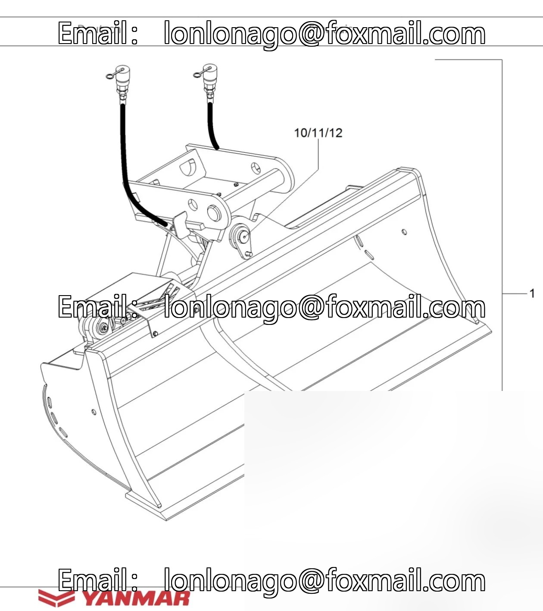
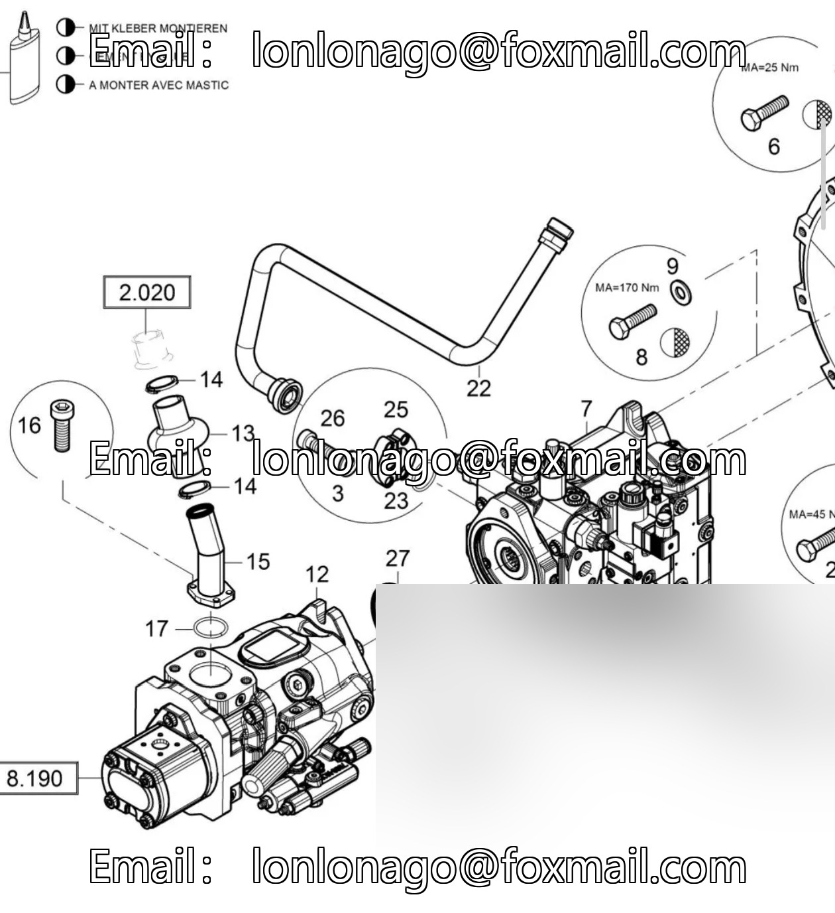
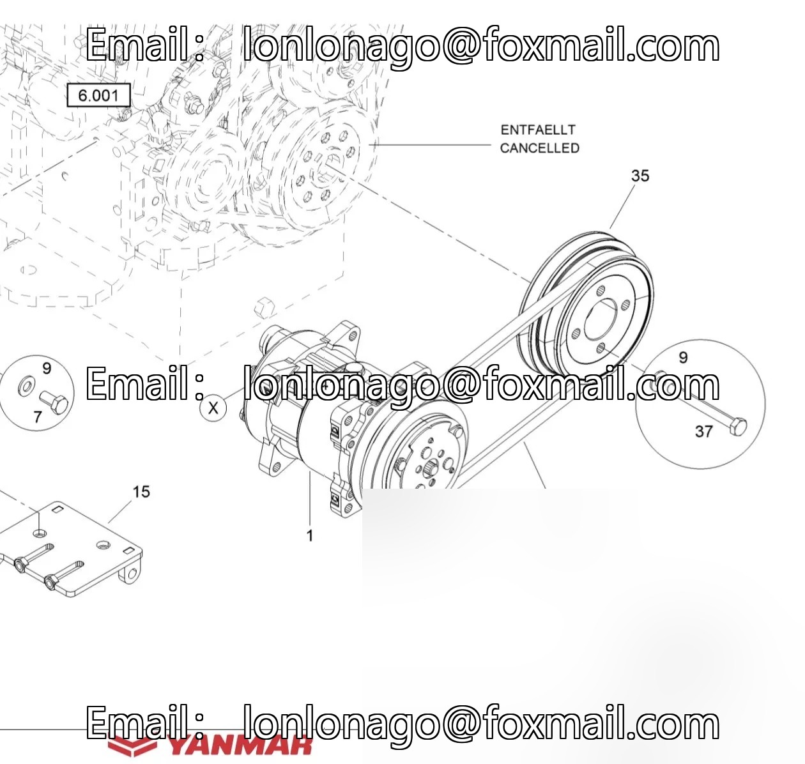
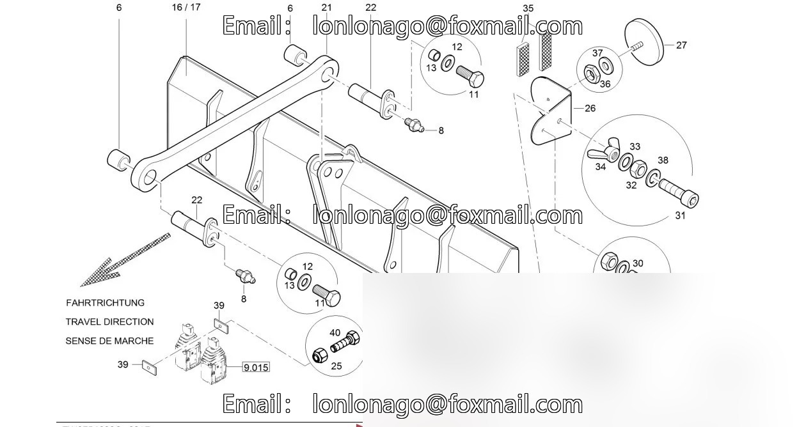

# Gallery part directory for YANMAR B75W wheeled excavator, PDF

## Body

The diagram and part catalog of the YANMAR B75W wheel excavator, PDF , 700 pages.
The content of the material includes detailed structural diagrams and part numbers for each component of the excavator, suitable for professional purposes such as equipment maintenance, disassembly, and parts procurement.
The is replicable, and cannot be refunded or exchanged upon sale.
749933632

The catalog is for the Yamada (YANMAR) B75W wheeled excavator, comprising an illustrated parts directory in PDF format with 700 pages; it covers detailed structure diagrams and part numbers for all excavator components, suitable for equipment maintenance, disassembly, and parts procurement.

<!-- AI_ENRICHED -->

## Images

## Payment

Here is a pay link on Stripe ( https://buy.stripe.com/3cs8yP7sY87d0vu9AB ). Please contact me lonlonago@foxmail.com after funding $89, and I will send you a complete data files , thank you!

